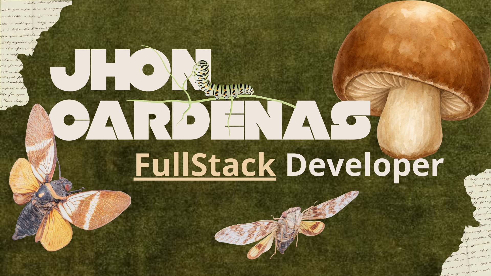

 

**Aprendiz de Análisis y Desarrollo de Software (SENA) · Backend / Full Stack junior**

📍 Sogamoso, Boyacá, Colombia

---

## Sobre mí

Soy Jhon, aprendiz del **Tecnólogo en Análisis y Desarrollo de Software (ADSO) del SENA**. Me interesa el desarrollo de aplicaciones web y construir soluciones de software que funcionen de principio a fin: base de datos, lógica y vista.

En mi formación he desarrollado proyectos académicos sobre sistemas de información, gestión de usuarios, bases de datos y arquitecturas por capas.

Estoy abierto a oportunidades como desarrollador **Backend / Full Stack junior**.

---

## Stack

**Lenguajes**

**Desarrollo web**

**Bases de datos**

**Herramientas**

---

## Proyectos destacados

| Proyecto | Qué hace |
|---|---|
| [**FINTRIX**](https://github.com/Alejandro-CP-dev/fintrix) | Aplicación para la gestión de finanzas personales, en Java. |
| [**FitCimm**](https://github.com/Alejandro-CP-dev/fitCIMM) | Sistema para gestionar la información de un gimnasio: socios, planes y membresías, en Java. |
| [**DisPet**](https://github.com/Alejandro-CP-dev/DisPet-DispensadorDeComidaAutomatizado) | Proyecto de negocio propio: dispensador automático de comida para mascotas. |
| [**Mesa de Ayuda**](https://github.com/Alejandro-CP-dev/MesaDeAyuda) | Sistema de tickets de soporte en Java Web (Servlets y JSP). |
| **PlanMejoramiento** | Sistema web en ASP.NET WebForms para gestionar información académica: usuarios, aprendices, instructores, fichas y programas. |
| **Distribuidora Keppler** | Sistema de gestión para distribución, usuarios, clientes y productos, en ASP.NET WebForms con arquitectura por capas. |

---

## Formación

**Tecnólogo en Análisis y Desarrollo de Software**
Servicio Nacional de Aprendizaje, SENA · 2025 – 2027
